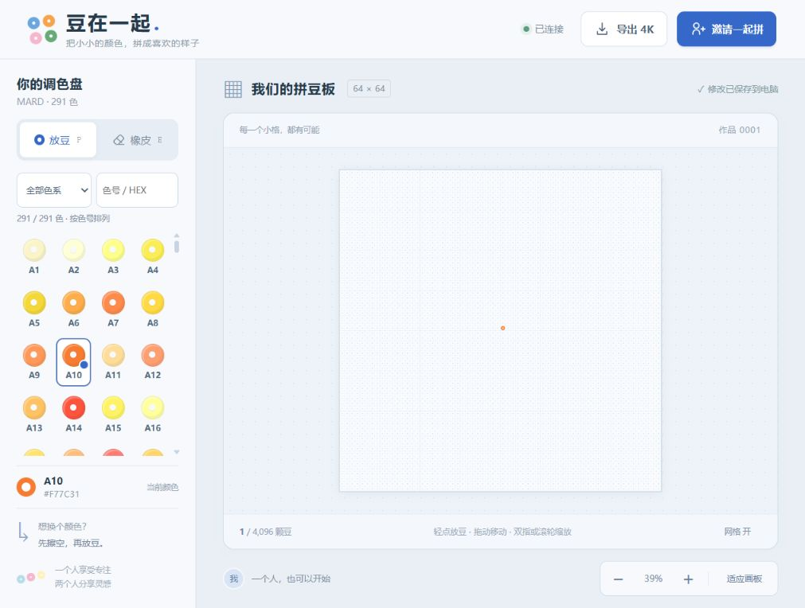
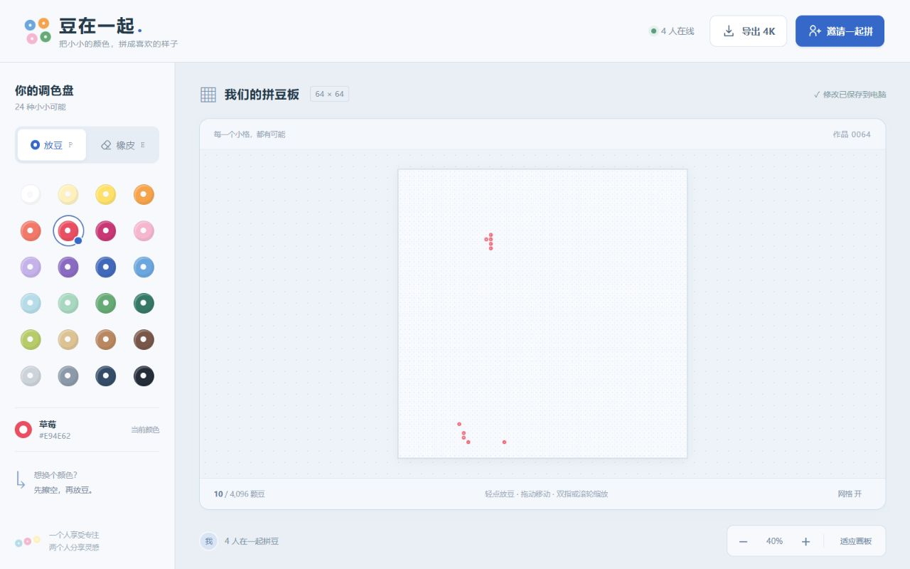

# pingdou · 豆在一起 · 第一版

在同一张板上，一格一豆地完成作品。一个人就能开始，也可以让手机、电脑和平板通过同一个邀请链接一起加入。

项目已独立放在 `C:\Users\35115\Documents\ChatGPT\pingdou`。代码、启动入口、依赖、穿透工具和已有作品存档均在这个文件夹中，后续从这里启动和维护。

## 已实现

- 默认 64 × 64 拼豆板，支持 8–256 行、8–256 列的矩形画布，MARD 291 色调色盘、放豆、橡皮与移动工具。
- 色块显示色号，支持色系筛选与色号 / HEX 搜索，组内按数字升序排列。
- 电脑单击放豆，普通拖动移动板面，左键配合 W/A/S/D 连续放豆；触屏单指沿轨迹绘制，双指移动缩放。
- 已有豆不能直接换颜色，必须先擦除；所有参与者可以互相擦除。
- 本机服务校验每次操作，双方争抢一个空格时只接受一个有效操作；延迟的旧操作不会误擦新豆。
- 单人直接开始，不等待另一人；后来加入者看到已有作品。
- 自动保存到电脑，断线重连和服务重启后恢复。
- 4096 × 4096 PNG 导出，由电脑生成，手机也可下载。导出为白底平整色块，不含工具栏、网格和选中框。
- 电脑鼠标、键盘，以及手机布局与指针手势；支持拖动移动、双指或滚轮缩放，也有缩放按钮。

## 现在开始使用

需要 Windows 和 Node.js 24 或更新版本。本次制作环境已安装 Node.js 与运行依赖。

1. 双击 **启动拼豆.cmd**。首次缺少依赖时会自动安装。
2. 自动打开本机网页，完整链接也会显示在启动窗口中。
3. 选颜色，轻点空格放豆。需要换色时，先选橡皮擦空，再选颜色放豆。

服务已经运行时，使用原来的完整链接打开即可。重复启动会提示端口被占用，不会清空作品。

本机地址以 `http://127.0.0.1:3210/` 开头，末尾 `#` 后面是房间密钥。只打开不带密钥的地址时，网页会要求粘贴完整邀请链接或密钥。不要直接双击 `public/index.html`，页面需要本机服务来同步与保存。

如果直接打开了 HTML，页面现在会显示“先启动拼豆小屋”的指引。请返回项目根目录双击“启动拼豆.cmd”，使用它自动打开的页面；仅把资源路径改为本地路径不能代替同步与保存服务。此前直接打开文件会出现 `file:///C:/styles.css` 找不到以及模块脚本的 CORS 错误，新的启动保护会避免请求应用模块并明确提示正确入口。

## 邀请手机或朋友

1. 保持拼豆服务运行，再双击 **启动穿透.cmd**。
2. 程序使用 Cloudflare 官方 Windows 便携版建立临时通道；缺少便携版时从官方 GitHub 下载，并检查 Cloudflare 的数字签名。
3. 等待窗口出现 `https://…trycloudflare.com/#…` 完整链接。程序会打开它，也会把链接保存在本机 `data/public-url.txt`。
4. 在公网页面点击“邀请一起拼”，复制完整链接给另一人；手机直接用浏览器打开。两台设备可以位于不同网络。
5. 电脑服务、穿透程序以及电脑本身都需要保持运行。临时通道重开后公网地址会变化，作品与房间密钥仍保留。

手机上的 `localhost` 或 `127.0.0.1` 指向手机本身，不能用来访问电脑。跨设备请使用上一步生成的公网完整链接。

持有完整邀请链接的人都可以读取作品、放豆、擦豆和导出。第一版没有账号和人数硬限制，以少量参与者共同使用为目标。

Cloudflare Quick Tunnel 不需要账号或域名，临时地址没有持续可用保证。若网络无法连接它，可以把其他支持 WebSocket 的穿透工具映射到同一个本地端口。官方说明：[Quick Tunnel](https://developers.cloudflare.com/tunnel/get-started/quick-tunnels/)、[Windows 下载](https://developers.cloudflare.com/tunnel/downloads/)。

穿透入口会阻止重复或同时启动，避免留下多个通道。预检或下载时按 Ctrl+C 会取消启动；下载使用临时文件，通过签名检查后才安装，失败后可以重试。若异常关闭窗口后提示遗留锁，请确认原穿透已退出，再运行“停止服务.cmd”清理记录，然后重新启动拼豆与穿透。这个停止入口会同时停止本机拼豆服务，作品文件会保留。

## 手机操作与导出

手机与窄竖屏平板优先为画布分配空间，短屏可向下滚动查看工具和色盘；色盘自身仍可独立滚动。空画布提示位于画板下方的信息栏，不覆盖格子。切换横竖屏时，适应模式会重新完整显示画布；手动缩放后保持画板中心位置，可按“适应画板”恢复全景。

- 轻点一个格子放豆或擦豆；轻微手指抖动有容差。
- 放豆或橡皮工具下，单指沿轨迹连续操作，补齐经过的中间格子；已有豆不会被直接覆盖。双指移动和缩放；选择“移动”工具后可单指移动板面。
- 格子太小时用“+”或双指放大；“适应画板”恢复整板视图。
- 调色盘可独立上下滚动，也可筛选色系或搜索色号；放豆与橡皮按钮保持在画板下方。
- 点击“导出 4K”，等待电脑生成文件。浏览器下载的 PNG 为 4096 × 4096；手机在浏览器下载列表或“文件”中找到图片，再按系统入口保存到相册。网页不能保证自动写入相册。
- 导出期间其他人可以继续拼豆；文件固定为导出开始时的已保存版本，不混入生成期间的新修改。

## 画布管理与连续绘制

画板上方提供“我的画布”下拉列表以及“新建”“扩展”“清盘”按钮。

- **清盘**：确认后清空当前画布，尺寸不变；清空前自动保存“原名称 · 清盘备份”，可从下拉列表重新打开。
- **扩展**：填写新的列数和行数，仅向右、向下扩展，原有豆豆行列位置不变，不允许缩小。
- **新建**：填写名称和尺寸，当前作品保留在列表中，新画布保存成功后再切换。旧作品可以重新打开继续编辑。
- **行列坐标**：顶部是列号、左侧是行号，从 1 开始。缩小时减少刻度，放大后逐格显示；悬停或键盘选中格子时显示精确行列。
- **电脑连放**：在起点格按住左键，再按住 W / A / S / D，分别向上 / 左 / 下 / 右连续放置当前颜色。松开鼠标或方向键停止发送新操作，已提交的操作会完成保存。到边界停止，已有豆的格子跳过。
- **触屏绘制**：手机、平板或触控笔沿轨迹连续绘制，快速移动时补齐经过的格子。保存队列未完成时暂时不能切换画布或导出；切换颜色后，已排队的轨迹仍使用原颜色。
- 断线、切到后台、窗口失焦或画布被他人切换时停止连续操作；未发送的轨迹不会在恢复连接后自动重放。

房间里的所有人查看同一张当前画布，清盘、扩展、新建和切换都会同步。如果确认弹窗打开期间其他人修改了画布，操作会被拒绝并同步最新内容，请查看后重新操作。

所有画布及清盘备份保存在本机同一个 `data/room.json` 中，随正常保存原子写入；备份整个 `data/` 目录即可一起保存。矩形作品导出时保持方形格子比例，居中放入 4096 × 4096 白底 PNG。

更新后先停止旧的拼豆服务，再双击“启动拼豆.cmd”，并刷新所有参与者的页面。

## 291 色色盘

色表采用用户指定的 [makebead/craft-color-codes 的 mard-291.csv](https://github.com/makebead/craft-color-codes/blob/main/data/csv/mard-291.csv)，实际包含 291 个色号。来源、固定版本、许可证和本地基准色调整见 [色表来源记录](vendor/makebead/README.md)。数据已随项目保存，使用时不需要联网读取色卡。

排列顺序是 A（黄橙肤色）、B（绿色）、C（蓝青色）、D（紫色）、E（粉色）、F（红色）、G（棕大地色）、H（黑白灰）、M（莫兰迪），然后 P、T、R、Y、Q、ZG 扩展组。各组按数字自然升序排列，例如 A1、A2、…、A10。编号顺序并不保证实际明度单调递减，不为制造渐变而改动对应色号。

可先选择色系，再输入色号或 HEX；不限定色系时选“全部色系”。支持大小写和前导零，例如 `c07` 能找到 `C7`。点击色块后，当前颜色区显示所选色号；过滤列表不会改变已选颜色。手机色盘独立上下滚动，较矮屏幕会压缩色盘高度以保留画板空间。

按用户给定的基准，B7 使用 `#3EAE7C`、D5 使用 `#B34EC6`、H1 使用 `#FFFFFF`、H4 使用 `#868686`；其余色值沿用源 CSV。特殊材质系列使用单一屏幕参考色显示和导出，不模拟实物材质变化。

已有 24 色作品的每颗豆保留原始 RGB，不会强制匹配到相近的 MARD 色。兼容颜色仅在内部用于旧作品显示和导出，不混入 291 个可选色号。加载时只转换内存，下一次主动放豆或擦豆时才随正常保存写回；房间密钥、格子版本与作品版本均保留。更新后重新启动拼豆服务并刷新页面即可使用。

本次色盘验证：48 项自动化测试通过，覆盖完整色号、源数据对应、筛选索引、旧色保留、新旧混色 4K PNG、末尾扩展色同步和重启恢复；`npm.cmd run check` 通过。浏览器验证桌面和 360 × 780、360 × 619 手机视口，无页面横向溢出；真实手机触屏手感未在本次验证。



[291 色手机预览](docs/palette-mobile.png)

## 保存、停止与恢复

作品保存在本项目的 `data/room.json`，包含板面与房间密钥。每次修改写入成功后，界面才显示成功。保留这个文件就能保留作品和邀请密钥；日常备份可以复制整个 `data/` 目录。不要把这个数据文件公开上传。

前台启动的服务可按 **Ctrl+C** 停止。制作时为方便预览启动的后台服务，可双击 **停止服务.cmd** 停止；它只停止本项目记录并校验过的进程。重新运行“启动拼豆.cmd”会恢复已保存作品。

如果提示本机数据损坏，先备份 `data/room.json` 再检查，程序不会自动把它清空。断网或连接中断期间不能提交操作；恢复连接后读取服务器最新作品，不会把旧点击重放。单人使用也需要电脑上的服务运行。

## 技术运行与验证

```powershell
cd "C:\Users\35115\Documents\ChatGPT\pingdou"
npm.cmd install
npm.cmd start
npm.cmd test
```

默认仅监听 `127.0.0.1:3210`，静态页面与 `/ws` 共用端口。可通过环境变量 `PORT` 修改端口，启动穿透时沿用同一个值。使用 Node.js 内建模块和 `ws`；没有云数据库、在线字体或远程图片依赖。

关键文件：`src/board.mjs` 是拼豆规则，`src/store.mjs` 是本机保存，`src/server.mjs` 是实时服务，`src/png-worker.mjs` 是图片生成，`public/` 是界面。

设计与制作记录：[设计说明](docs/superpowers/specs/2026-10-21-collaborative-bead-board-design.md)、[实施计划](docs/superpowers/plans/2026-10-21-bead-room.md)、[进度与验证记录](docs/superpowers/plans/2026-10-21-bead-room-progress.md)。

本次验证记录：

- 41 项自动化测试通过，覆盖规则、并发、鉴权、损坏文件保护、写入失败、重启恢复、快照衔接、触控取消、待确认操作保护，以及穿透入口的取消、启动失败、独占锁、部分写入清理和下载重试。
- 实际解码生成的 PNG，检查 4096 × 4096 尺寸、准确颜色、白底和快照不变性。
- 在浏览器中运行两个独立窗口，验证放豆、禁止直接换色、另一窗口擦豆及双方同步。
- 在 360 × 780 手机视口检查布局和单格操作，在 1280 × 800 桌面视口检查排版；未发现横向页面溢出。当前窄屏页面的可见按钮点击区域均至少为 44 CSS 像素，浏览器错误和警告记录为空。这些不是 iOS/Android 真机测试。双指与取消边界使用指针状态机测试验证，仍需真实触屏设备确认手感。
- 浏览器实际完成 4K 文件下载；手机系统相册保存未做真机验证。
- 自动审批拒绝直接启动公网穿透，仅返回“策略阻止”。因此已准备官方程序和启动入口，未宣称公网端到端访问验证通过。用户手动运行穿透后可进行手机跨网络测试。
- PowerShell 停止脚本已做源码与语法检查；在临时目录执行锁清理函数的验证也被自动审批以“策略阻止”拒绝，未绕过限制。因此 Windows 停止与陈旧锁清理尚未做执行验证。



[手机界面预览](docs/preview-mobile.jpg)
