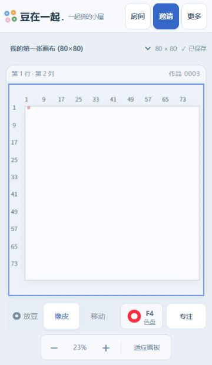

# pingdou · 豆在一起

在自己的拼豆房间里，一格一豆地完成作品。支持单人操作，也支持手机、平板和电脑通过邀请码实时协作。

## 启动

需要 **Node.js 24+**。Windows 双击 **启动拼豆.cmd**，保持窗口和电脑运行。服务默认只监听 `127.0.0.1:3210`。

本机启动会打开原有作品。点击顶部 **房间**，可以创建新房间或输入邀请码加入其他房间。直接打开不带凭据的网站地址时，会显示创建 / 加入入口。

不要直接双击 `public/index.html`；直接打开文件时会显示启动指引，实际绘制、同步和保存需要服务。

## 创建房间与邀请

1. 点击 **房间 → 创建房间**，填写房间名称和自定义邀请码，也可以点“随机生成”。
2. 邀请码为 **8–32 位英文字母、数字、短横线或下划线**，不区分大小写，忽略两端空格。同一托管服务内不能重复。
3. 电脑上双击 **启动穿透.cmd**，等待显示公网网站地址。
4. 在公网网站输入自己的邀请码进入房间，再点击 **邀请**。可以复制网站地址、邀请码，或完整邀请说明给朋友。
5. 朋友打开网站，选择“加入房间”，输入邀请码，即可一起拼豆。

**网址和邀请码分开。** 穿透重启后网址可能变化，房间、邀请码和作品仍然保留。朋友需要当前有效的网站入口；邀请码不能脱离网站自动定位互联网上的电脑。每台独立运行服务的电脑拥有各自的房间集合。

手机上的 `localhost` 和 `127.0.0.1` 指向手机自身，跨设备需使用穿透提供的网址。电脑上的拼豆服务、穿透程序都需保持运行。Cloudflare Quick Tunnel 是临时通道，不保证网址持续可用。

各房间的豆豆、画布库、当前画布、在线人数和保存队列相互独立。房间不公开列出；知道邀请码的人可以加入、放豆、互相擦除、管理画布和导出。目前没有账号、房主专属权限或踢人功能。

原有完整邀请链接仍然有效。进入原有房间后，点“邀请”可以为它设置邀请码；设置过程不替换旧密钥或重写作品。通过旧链接进入、但当前浏览器不知道已设邀请码时，需要输入正确的邀请码验证后才能显示和复制。

当前标签页刷新后会恢复房间；关闭标签页、使用另一浏览器或访问新穿透域名时，可以重新输入邀请码。请自行保存邀请码，服务器不保存其明文。

## 画布优先界面

- **色盘可以收起**：点击工具栏中的当前颜色 /“色盘”，或面板上的“收起”。电脑默认展开侧栏；手机和窄竖屏平板默认收起。
- **主要工具常驻**：色盘关闭后，放豆、橡皮、移动、当前颜色、缩放和适应画板仍可用。
- **专注模式**：点击“专注”隐藏辅助信息，点击“退出专注”恢复。布局设置只保存在当前设备，不影响同房间其他人。
- **更多**：新建、扩展、清盘、导出 4K、网格开关和操作帮助收在顶部“更多”中。
- **工作区利用剩余视口**：色盘展开后位于画布外的独立区域，色块可滚动；空画布提示不盖住格子。横竖屏或面板变化后，适应模式重新显示完整画板；手动缩放时保留中心位置。

## 放豆和移动

- 每个格子只能有一颗豆；更换颜色前必须先擦除，参与者可以互相擦除。
- 电脑轻点操作一格，普通拖动移动板面。按住左键配合 **W / A / S / D** 分别向上 / 左 / 下 / 右连续放豆，到边界停止。
- 手机、平板单指按轨迹连续操作，双指移动缩放；选择“移动”后可单指平移。
- 点击“+”或双指放大，点击“适应画板”恢复完整画布。
- 方向键选择格子，回车放豆或擦除；P / E 切换放豆 / 橡皮。输入框和对话框内不会触发绘制快捷键。
- 断线或进入后台会停止连续操作；恢复后加载已保存作品，不重放旧笔画。
- 正在保存的操作完成后才能切换房间、切换画布或导出。已有的连续绘制发送节奏沿用原实现，本轮未宣称解决公网触屏延迟。

## 画布管理与导出

画布支持 **8–256 行、8–256 列**，默认新建 64 × 64。

- **新建**：保留旧作品，新画布成功保存后切换。
- **扩展**：只向右、向下增加面积，原有豆的行列坐标保持。
- **清盘**：确认后清空；操作前自动保存“原名称 · 清盘备份”，可从画布下拉列表重新打开。
- **行列定位**：顶部显示列号，左边显示行号；选中格子显示精确行列，缩小时减少刻度。
- **同房间同步**：新建、扩展、清盘和切换当前画布会同步整个房间。弹窗打开后若画布已被他人修改，旧操作会被拒绝并同步最新内容。

导出入口在 **更多 → 导出 4K**，得到 **4096 × 4096 PNG**。文件不含工具栏、网格或选中框；矩形作品保持方形格子比例，居中置于白底。导出使用开始时的画布快照，其他人的后续修改不会混入图片。

手机可在浏览器下载列表或“文件”中找到 PNG，再保存到相册。服务一次生成一张图片，以控制资源使用。清盘备份是画布恢复机制，当前没有逐笔撤销功能。

## 291 色色盘

采用用户指定的 [makebead/craft-color-codes 的 mard-291.csv](https://github.com/makebead/craft-color-codes/blob/main/data/csv/mard-291.csv)，实际提供 291 个可选色号。数据随项目保存，运行时不用联网读取。

排列为 A、B、C、D、E、F、G、H、M，然后 P、T、R、Y、Q、ZG，组内按数字自然升序。支持色系筛选、色号 / HEX 搜索及前导零。按已确认基准，B7 使用 `#3EAE7C`、D5 使用 `#B34EC6`、H1 使用 `#FFFFFF`、H4 使用 `#868686`。

已有 24 色作品保留原始 RGB，不强制匹配到相近颜色。来源、固定版本和许可证见 [色表记录](vendor/makebead/README.md)。

## 保存、备份与停止

**备份整个 `data/` 目录**：

| 文件 | 内容 |
| --- | --- |
| `data/room.json` | 原有房间的作品、画布库和旧密钥 |
| `data/rooms/<uuid>/room.json` | 新房间的作品、画布库与房间信息 |
| `data/room-index-key.json` | 邀请码索引密钥 |
| `data/legacy-room-meta.json` | 原有房间设置邀请码后的元信息 |
| `data/public-url.txt` | 当前穿透入口，仅供本机查看 |

不要单独删除或重建索引密钥，否则已有邀请码将无法验证。文件损坏时程序保留原文件并报告错误，不会把作品自动清空。作品和密钥不提交到 GitHub。

保存成功后才确认并同步操作。正常停止可在服务窗口按 **Ctrl+C**，或使用 **停止服务.cmd**；停止不清空作品。更新后先停止旧服务，再双击启动并刷新各设备页面。

穿透入口会阻止重复启动。下载官方 Cloudflare 便携版时会校验数字签名，退出或取消时清理本次进程记录。若提示遗留锁，先确认原穿透已退出，再用停止入口清理。也可将其他支持 WebSocket 的穿透工具映射到相同本地端口。

## 开发与验证

```powershell
npm.cmd install
npm.cmd start
npm.cmd test
npm.cmd run check
```

使用 Node 内建模块和 `ws`，没有云数据库、在线字体或远程图片依赖。通过环境变量 `PORT` 可修改端口。自动化测试全部使用临时目录，不修改真实作品。

关键代码：`src/rooms.mjs` 管理房间目录和邀请码，`src/server.mjs` 负责连接、分房间同步和保存，`src/board.mjs` 校验拼豆规则；`public/rooms.mjs` 负责加入界面，`public/workspace.mjs` 负责面板设置。

本轮设计与验证见 [多房间设计](docs/superpowers/specs/2026-10-23-rooms-and-canvas-workspace-design.md)、[实施记录](docs/superpowers/plans/2026-10-23-rooms-and-canvas-workspace.md)。浏览器模拟可验证布局和事件流程；真实 iOS / Android 的触控手感、软键盘及公网延迟仍需真机确认。


